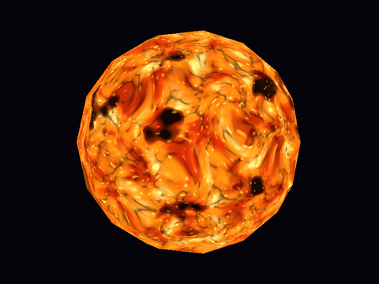
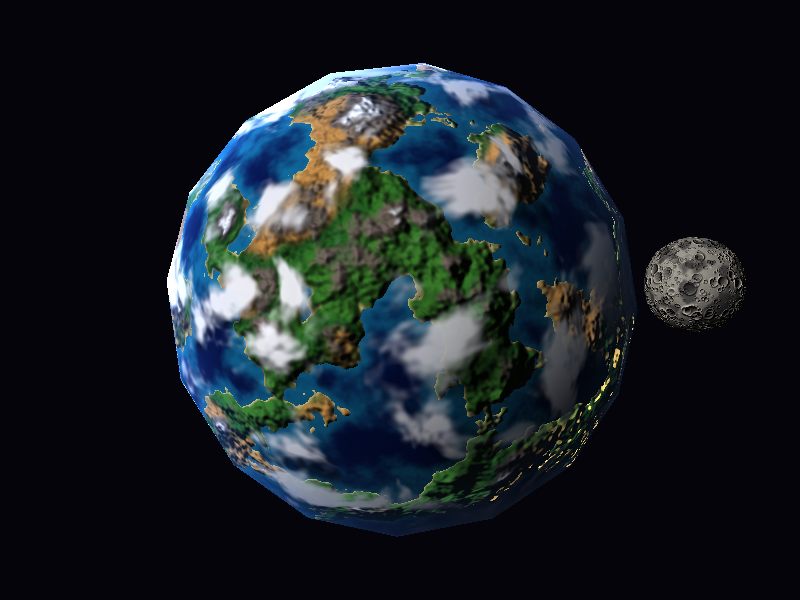
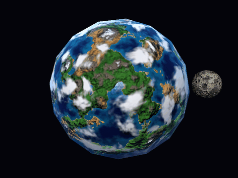
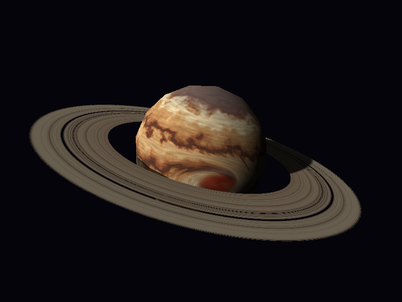
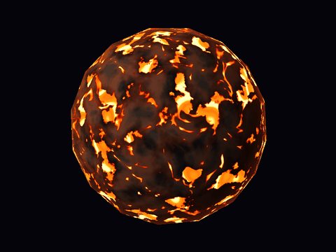
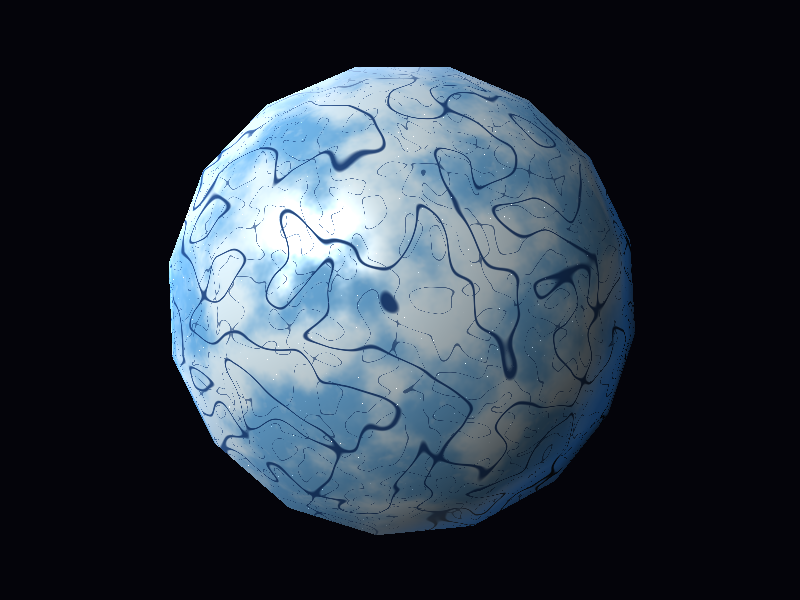
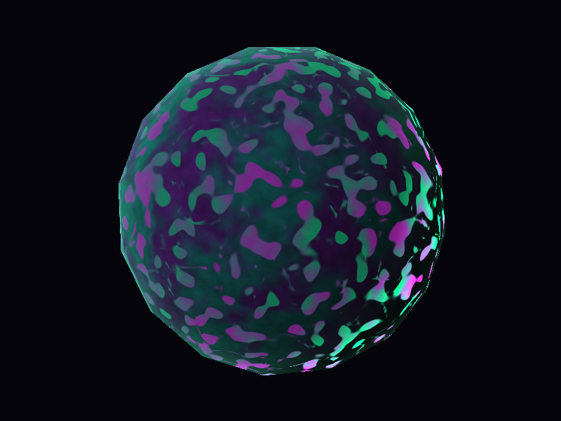

# Lab 6 - Planetas y estrellas con shaders

Seis cuerpos celestes dibujados con **fragment shaders procedurales en CPU** sobre la misma esfera (`models/sphere.obj`). No se usan texturas ni imágenes: todo el color sale de funciones matemáticas y ruido simplex 3D. La geometría no se modifica; solo los anillos usan un disco generado por código.

## Cómo compilar y ejecutar

Requisitos: Rust (edición 2024), y para compilar raylib: CMake y un compilador de C.

```
cargo run --release
```

Controles de la ventana:

| Tecla | Acción |
|---|---|
| `1` | Estrella |
| `2` | Planeta rocoso (con luna) |
| `3` | Gigante gaseoso (con anillos) |
| `4` | Planeta de lava |
| `5` | Planeta de hielo |
| `6` | Planeta bioluminiscente |
| `L` | La luz da vueltas alrededor del planeta (muestra día/noche, terminador y sombras de nubes en movimiento) |

Otros comandos:

```
cargo run --release -- --save-images                      # guarda una captura de cada cuerpo en images/
cargo run --release -- --save-frames 2 80 0.13 --orbit-light   # <cuerpo 1-6> <cuadros> <dt>: guarda cuadros en frames/
python tools/make_gifs.py                                 # arma los GIFs de media/ (requiere Pillow)
```

## Estructura

```
src/main.rs            ventana, selección de cuerpo por teclas, escenas
src/renderer.rs        pipeline: vértices -> rasterización -> profundidad -> fragment shader (en hilos)
src/rasterizer.rs      relleno de triángulos con baricéntricas (como el Lab 5), con interpolación en perspectiva
src/noise.rs           ruido simplex 3D, fbm, ridged y hash de celdas
src/shaders/           un archivo por cuerpo: star, rocky, moon, gas, rings, lava, ice, alien
```

El ruido se evalúa sobre el **punto 3D de la esfera** (no sobre UV), así que no hay costuras en los polos ni en el meridiano. Es ruido simplex 3D, de la misma familia que OpenSimplex.

---

## Los tres cuerpos obligatorios

### 1. Estrella — `src/shaders/star.rs` (`star`)


Una estrella que emite su propio color y no depende de la luz externa. Cuatro capas de color:

1. **Temperatura:** `fbm` de baja frecuencia mezcla rojo oscuro, naranja y amarillo-blanco.
2. **Granulación:** las crestas del ruido `ridged` son los bordes de celdas de convección y se oscurecen.
3. **Manchas solares:** `fbm` con umbral, restringido al ecuador, con umbra y penumbra.
4. **Limbo y fulguraciones:** el borde se oscurece y brilla en naranja, con destellos brillantes.

Todo se muestrea con una **distorsión de dominio** (el punto se desplaza con ruido que cambia en el tiempo), por eso la superficie hierve en vez de deslizarse.

| Parámetro | Efecto visual |
|---|---|
| `GRANULE_SCALE` | tamaño de los granos de convección |
| `SPOT_THRESHOLD` | más alto = menos manchas solares |
| `WARP_STRENGTH` | cuánto se retuerce la superficie |
| `FLOW_SPEED` | velocidad de la animación |
| `FLARE_STRENGTH` | brillo de las fulguraciones |



### 2. Planeta rocoso — `src/shaders/rocky.rs` (`rocky`) + luna `src/shaders/moon.rs` (`moon`)



Cuatro capas de color:

1. **Terreno:** un campo de altura (`fbm`, función `height`) decide océano o tierra. Un segundo campo de humedad reparte bosque, pasto y desierto. Por altura aparecen playa, roca y nieve. Hay hielo en los polos.
2. **Iluminación con respuestas distintas:** el océano tiene reflejo especular y olitas animadas, el hielo un brillo suave y la tierra queda mate.
3. **Lado nocturno:** luces de ciudades que solo aparecen donde no llega el sol.
4. **Nubes:** máscara de ruido con cobertura ajustable (`cloud_mask`) que se mueve a su propio ritmo, distinto al del terreno. Hay además un halo azul de atmósfera.

| Parámetro | Efecto visual |
|---|---|
| `SEA_LEVEL` | más alto = más océano, menos tierra |
| `TERRAIN_SCALE` | tamaño de los continentes |
| `CLOUD_COVER` | más alto = cielo más despejado |
| `CLOUD_SPEED` | velocidad de las nubes respecto al terreno |
| `CLOUD_HEIGHT` / `SHADOW_STRENGTH` | separación y oscuridad de las sombras de nubes |
| `BUMP_STRENGTH` | relieve visible en tierra |
| `OCEAN_SPECULAR` | brillo del reflejo en el océano |

**Luna** (`moon`): segunda instancia de la misma esfera, escalada y orbitando el planeta (siempre muestra la misma cara). Los cráteres salen de una rejilla 3D con un hash por celda (centro y radio aleatorios, con borde elevado), más mares oscuros y relieve por bump mapping. Parámetros: `CRATER_SCALE` (cantidad y tamaño de cráteres) y `CRATER_BUMP` (profundidad aparente).

Animación con la luz orbitando (se ven el día, la noche con ciudades, el terminador y cómo se desplazan las sombras de las nubes):



### 3. Gigante gaseoso — `src/shaders/gas.rs` (`gas_giant`) + anillos `src/shaders/rings.rs`



Cuatro capas de color:

1. **Bandas con bordes líquidos:** la latitud se perturba con `fbm` antes de mapearla a una paleta de 5 colores; así los límites entre bandas ondulan y se mezclan.
2. **Filamentos:** ruido estirado en latitud agrega hebras finas a lo largo de las bandas.
3. **Tormenta:** una distorsión localizada (ver efectos) que curva las bandas a su alrededor, con núcleo rojo, brazos espirales y un collar claro.
4. **Atmósfera:** polos grisáceos, terminador suave, neblina en el borde y la sombra de los anillos sobre el planeta.

Cada banda se desplaza a distinta velocidad (corriente diferencial), lo que anima el material.

| Parámetro | Efecto visual |
|---|---|
| `BAND_FREQ` | número de bandas |
| `TURBULENCE` | cuán onduladas y mezcladas son las transiciones |
| `FLOW_SPEED` | velocidad de las corrientes |
| `STORM_TWIST` | cuánto se enrollan las bandas alrededor de la tormenta |
| `STORM_RX` / `STORM_RY` | tamaño de la tormenta |

**Anillos** (`rings`): disco generado por código (`Mesh::ring`) con apariencia 100 % procedural: anillos finos por ruido, una división tipo Cassini y bordes que se desvanecen. Los huecos se **descartan** antes de la prueba de profundidad (como `discard` en GLSL), así se ve el planeta a través de ellos. El planeta proyecta sombra sobre los anillos y los anillos sobre el planeta. Parámetros: `RING_INNER`, `RING_OUTER`, `GAP_POSITION`, `RING_FREQUENCY`.


---

## Planetas extra

### Planeta de lava — `src/shaders/lava.rs` (`lava`)


Corteza de basalto (se ilumina) sobre lava emisiva (brilla sola). Las grietas son crestas de ruido `ridged` deformadas por otro ruido; los mares de lava aparecen donde la altura es baja. El color va de rojo oscuro a amarillo-blanco según la temperatura y un pulso lo hace respirar. Parámetros: `CRACK_SCALE`, `CRACK_THRESHOLD` (grosor de grietas), `LAVA_SEA` (cantidad de lava), `PULSE_SPEED`.



### Planeta de hielo — `src/shaders/ice.rs` (`ice`)



Placas de hielo grueso (blanco) y delgado (azul), fracturas largas hechas con líneas de ruido, escarcha, casquetes polares, brillo especular (más fuerte en el hielo liso), destellos de cristales y luz azul filtrada hacia el terminador. Parámetros: `FRACTURE_SCALE`, `FRACTURE_THRESHOLD`, `GLOSS`, `SPARKLE`.

### Planeta bioluminiscente — `src/shaders/alien.rs` (`alien`)



Suelo violeta y verde azulado con venas y esporas que brillan con luz propia. De día el brillo se atenúa y de noche domina, así el planeta cambia por completo entre ambos lados. Parámetros: `SPORE_SCALE`, `SPORE_THRESHOLD` (cantidad de esporas), `VEIN_SCALE`, `PULSE_SPEED`.

---

## Efectos adicionales por los que se solicitan puntos

| Efecto | Cuerpo | Archivo y función | Evidencia | Cómo funciona y parámetro modificable |
|---|---|---|---|---|
| **Material animado** (5) | Estrella | `src/shaders/star.rs`, `star` | [GIF](media/estrella.gif) | El punto de muestreo se desplaza con ruido que cambia con el tiempo (distorsión de dominio) mientras la geometría no se mueve. `FLOW_SPEED` cambia la velocidad; `WARP_STRENGTH` cuánto hierve. |
| **Apariencia de día y noche** (5) | Planeta rocoso | `src/shaders/rocky.rs`, `rocky` (bloque "lado nocturno") | [GIF](media/planeta_rocoso_luz.gif) (tecla `L`) | Las luces de ciudades se multiplican por una máscara de noche (`1 - smoothstep` sobre `normal·luz`), así solo existen donde no llega el sol. Cambiar el umbral `smoothstep(0.62, 0.78, ...)` cambia cuántas ciudades hay. |
| **Respuestas diferentes a la iluminación** (10) | Planeta rocoso | `rocky.rs`, `rocky` (capa 2) | [GIF](media/planeta_rocoso_luz.gif) | Un océano brilla con reflejo especular Blinn-Phong y olitas, el hielo con un brillo suave y la tierra no tiene brillo. `OCEAN_SPECULAR` sube o baja el reflejo del mar. |
| **Nubes procedurales** (10) | Planeta rocoso | `rocky.rs`, `cloud_mask` | [captura](images/2_planeta_rocoso.png) y [GIF](media/planeta_rocoso_luz.gif) | Una máscara `fbm` con umbral se mezcla sobre la superficie y gira con `CLOUD_SPEED` independiente del terreno; no hay otra esfera. `CLOUD_COVER` ajusta la cobertura. |
| **Tormenta o vórtice localizado** (10) | Gigante gaseoso | `src/shaders/gas.rs`, `gas_giant` (bloque "Tormenta") | [captura](images/3_gigante_gaseoso.png) y [GIF](media/gigante_gaseoso.gif) | Se rotan las coordenadas locales alrededor del centro de la tormenta con un ángulo que decae con la distancia, y ese desplazamiento se aplica al punto donde se muestrean las bandas, que se curvan a su alrededor. `STORM_TWIST` cambia cuánto se enrollan las bandas. |
| **Relieve procedural con bump mapping** (15) | Planeta rocoso (también la luna) | `rocky.rs`, `rocky`; `src/shaders/mod.rs`, `bump_normal` | [captura](images/2_planeta_rocoso.png) | El campo de altura `height` se evalúa en 3 puntos cercanos para obtener su gradiente (diferencias finitas) y se inclina la normal con él. La luz usa esa normal y los vértices no cambian. `BUMP_STRENGTH` controla la profundidad aparente. |
| **Sombras de nubes** (20) | Planeta rocoso | `rocky.rs`, `rocky` (bloque "Sombras de nubes") | [GIF](media/planeta_rocoso_luz.gif) | Para cada punto del suelo se sigue el rayo hacia la luz hasta la altura de las nubes (`CLOUD_HEIGHT`) y se consulta la **misma** `cloud_mask`. La sombra es la de esa nube, se mueve con ella y se desplaza al cambiar la dirección de la luz. `SHADOW_STRENGTH` y `CLOUD_HEIGHT` cambian su oscuridad y su separación. |

Además de lo que pide el enunciado: sistema de anillos en el gigante gaseoso, luna en el planeta rocoso y tres planetas extra (lava, hielo y bioluminiscente).

## Notas

- `sphere.obj` es de baja resolución (192 triángulos), por eso la silueta se ve algo poligonal; la geometría no se modificó, como pide el laboratorio.
- El renderizado en CPU reparte el sombreado entre hilos; los FPS dependen del procesador.
